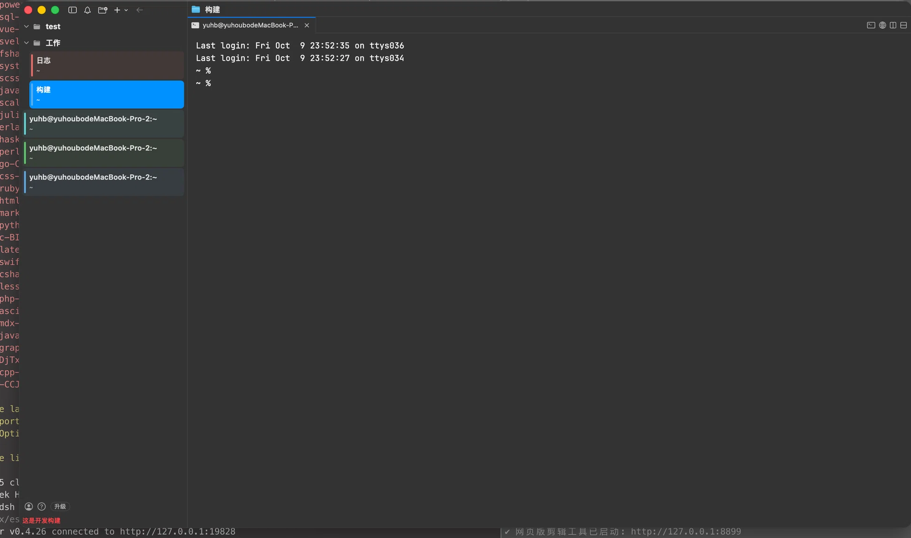

# toolmux

[](CHANGELOG.md)
[](https://developer.apple.com/macos/)
[](https://developer.apple.com/macos/)

**toolmux** 是一个基于 [Ghostty](https://github.com/ghostty-org/ghostty) 终端内核、以 [cmux](https://github.com/manaflow-ai/cmux) 为基础深度定制的个性化 macOS 终端管理器。



---

## 致谢与依赖

toolmux 站在两个优秀开源项目的肩膀上，向以下项目及其作者致以感谢：

| 依赖 | 项目 | 说明 |
|---|---|---|
| **Ghostty** | [github.com/ghostty-org/ghostty](https://github.com/ghostty-org/ghostty) | 终端模拟器核心（Zig 实现，GPU 加速渲染） |
| **cmux** | [github.com/manaflow-ai/cmux](https://github.com/manaflow-ai/cmux) | macOS 终端外壳（SwiftUI/AppKit 多会话管理） |

> cmux 的原始 README 保留在 [README.cmux.md](README.cmux.md)，包含完整的功能说明与文档索引。

---

## toolmux 的差异化功能

### 1. 左右分栏布局（20% / 80%）
- 侧边栏默认占窗口宽度的 **20%**，会话区占 **80%**
- 拖动分隔条可自由调整比例，宽度自动记住

### 2. 分组管理（左侧栏）
- 标题栏一键**新建分组**（无需右键），分组自动命名「分组 1、分组 2…」（从 1 递增取空闲号）
- 分组名称**加粗、大一号**显示，字号可通过右键菜单调整（增大/减小/重置）
- **单击分组名称 → 原地重命名**（不弹对话框）：回车提交、Esc 取消、失焦自动保存
- 单击分组行空白区域 → **折叠/展开**组内工作区
- 每个分组下可添加**多个工作区**（标题栏 ＋ 按钮 / 右键菜单 / 分组行 ＋ 悬停按钮）

### 3. 工作区标识色（左侧栏）
- 每个工作区行首有一条**彩色竖线**，背景带同色淡染，标题文字与竖线**同色**——一眼区分不同会话
- 颜色来源：工作区自定义色（右键可设）或按 workspace ID 稳定分配的 8 色调色板
- 浅色外观下颜色自动加深，保证可读性

### 4. 右侧会话页签
- 每个工作区右侧支持多个会话页签 + 分屏
- **单击已选中页签的标题 → 原地重命名**（回车提交、Esc 取消）
- 未选中页签单击标题仍是切换（不会误触编辑）

### 5. 标题栏快捷按钮
```
[侧栏开关] [铃铛] [📁＋新建分组(浅色底)] [＋新建工作区(实心强调色)] [◀ ▶]
```
- 新建分组：浅色底图标按钮（次级醒目）
- 新建工作区：**实心强调色**填充 + 白色加号（主操作，最醒目），右键可打开高级选项

### 交互速查

| 动作 | 效果 |
|---|---|
| 单击分组名称 | 重命名分组（原地编辑） |
| 单击分组行空白 | 折叠/展开组内工作区 |
| 单击工作区名称 | 重命名工作区（原地编辑） |
| 单击已选中页签标题 | 重命名页签（原地编辑） |
| 拖动侧边栏分隔条 | 调整左右比例 |
| 右键分组 → 字号菜单 | 增大/减小/重置分组名称字号 |

---

## 支持的平台

| 平台 | 状态 |
|---|---|
| **macOS**（Apple Silicon & Intel，14.0+） | ✅ **目前唯一支持的平台** |
| Linux | ❌ 暂不支持（上游 cmux/Ghostty 支持 GTK，toolmux 尚未适配） |
| Windows | ❌ 不支持 |

## 安装

### 方式一：下载安装包（推荐）

从 [Releases](https://github.com/EvansYu/toolmux/releases) 下载最新的 `toolmux-<版本>.dmg`，双击打开后将 **toolmux** 拖入 **Applications** 文件夹。

### 方式二：从源码构建

```bash
# 前置条件：Xcode 16+、Zig 0.16.x、Rust、Go
git clone --recursive https://github.com/EvansYu/toolmux.git
cd toolmux
./scripts/setup.sh

# 构建 Debug 版（日常开发迭代）
CMUX_DEV_BACKEND_MODE=local ./scripts/reload.sh --tag my-build

# 构建 Release 版并安装到 /Applications
xcodebuild -project cmux.xcodeproj -scheme cmux -configuration Release \
  -destination 'platform=macOS' build
ditto ~/Library/Developer/Xcode/DerivedData/*/Build/Products/Release/toolmux.app /Applications/toolmux.app
```

## 删除

```bash
# 退出应用后执行
rm -rf /Applications/toolmux.app

# （可选）清理应用数据
rm -rf ~/Library/Application\ Support/cmux
rm -rf ~/.config/cmux
```

---

## 版本

当前版本：**0.0.1**（后续版本从此序列递增）

## License

继承 cmux 的许可证（见 [LICENSE](LICENSE)）。Ghostty 核心遵循其 [MIT License](https://github.com/ghostty-org/ghostty/blob/main/LICENSE)。
